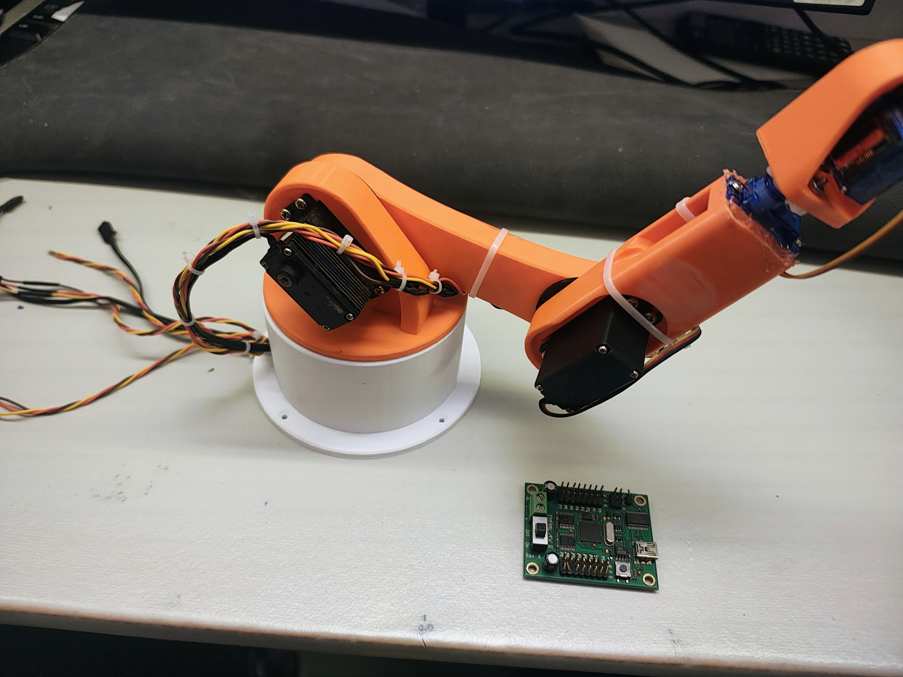
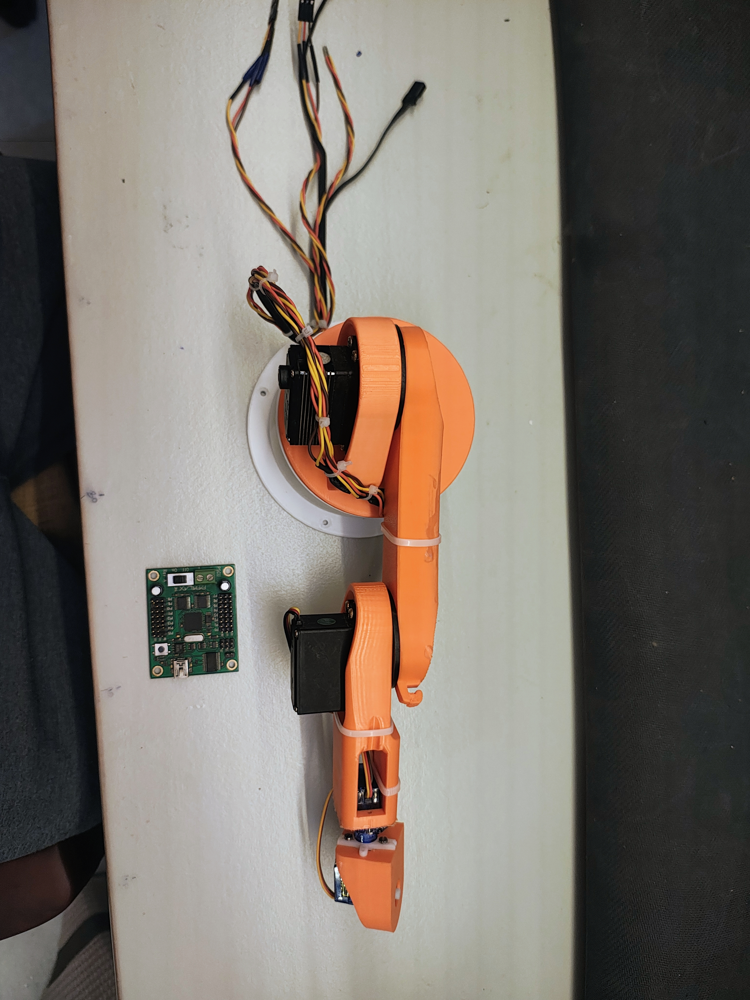

# RoboticsArm
This repository consist of activities that i am doing during my coursework on "Fundamental of robotics" at IITG.
I am using the following Robotic arm but i dont recommend using this one because there is not enough space for connecting the servo horn and one of the ARM. I had to do a lot of manual work which wasted the purpose of buying a 3D printed mini Robotics ARM

https://www.amazon.in/dp/B0GRRXLGY8/ref=twister_B0GRRZZ9YV?_encoding=UTF8&th=1

here is the image of the Modified arm attached. I have removed the gripper intentionaly as its difficult to model gripper as oper my initial understandings. 

The motor controller used is Parallax 16 channel Servo controller. The datasheet can be found below 
https://www.mouser.com/datasheet/2/321/28830-PropServoControllerUSB-v1.0-4872.pdf